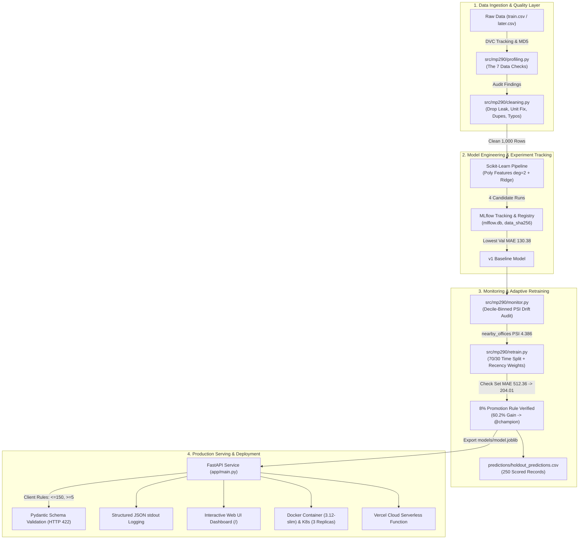

# Metro Station Crowd Prediction (Dehradun)

SCSE3040 MLOps Mini Project · **Group G134** · **Problem MP290**  
Bennett University · Faculty: Dr. Ravi Pratap · Batch 18

[](https://github.com/udbhav968-creator/MLOPS-ASSIGNMENT/actions)
[](https://mlops-assignment-nu.vercel.app/)
[](https://www.python.org/)
[](https://fastapi.tiangolo.com/)
[](https://mlflow.org/)
[](src/mp290/selfcheck.py)

---

## 🌐 Live Production Deployments & Deliverables

* **Interactive Web Dashboard**: [https://mlops-assignment-nu.vercel.app/](https://mlops-assignment-nu.vercel.app/)  
  *(Visual Metro crowd predictor, real-time gate actions, scenario presets, and client validation rule tester)*
* **Interactive API Documentation (Swagger UI)**: [https://mlops-assignment-nu.vercel.app/docs](https://mlops-assignment-nu.vercel.app/docs)
* **Service Health Endpoint**: [https://mlops-assignment-nu.vercel.app/health](https://mlops-assignment-nu.vercel.app/health)
* **Comprehensive Project Report (.docx)**: [`docs/G134_MP290_Comprehensive_Project_Report.docx`](docs/G134_MP290_Comprehensive_Project_Report.docx)  
  *(Detailed technical documentation with diagrams, team task breakdown, and viva Q&A guide)*

---

## 👥 Team Members & Task Allocation (Group G134)

| Enrolment No. | Name | Role (Plan Slot) | Subsystem Ownership & Commits |
|---|---|---|---|
| **S24CSEU1284** | **Pranjal Bisht** | **Data Lead (M1)** | `data/raw/*.dvc`, `params.yaml`, `config.py`, `profiling.py`, `cleaning.py`, `tests/test_data_checks.py` |
| **S24CSEU1277** | **Anshul Kundu** | **Model Lead (M2)** | `src/mp290/model.py`, `src/mp290/train.py`, `pyproject.toml`, Scikit-learn Pipelines, MLflow Tracking |
| **S24CSEU0505** | **Shivam Singh Anand** | **Service Lead (M3)** | `app/main.py`, `tests/test_api.py`, `Dockerfile`, `.dockerignore`, Interactive Web Dashboard |
| **S24CSEU1283** | **Prabhjot Singh** | **Ops Lead (M4)** | `.github/workflows/ci.yml`, `k8s/deployment.yaml`, `k8s/service.yaml`, `selfcheck.py`, Vercel Deployment |
| **S24CSEU0095** | **Udbhav** | **Monitoring Lead (M5)** | `src/mp290/monitor.py`, `src/mp290/retrain.py`, `src/mp290/pipeline.py`, `tests/test_monitoring.py`, Reports |

---

## 🚆 Problem Context: Dehradun Metro Rail Corporation

The Dehradun Metro Rail Corporation requires an automated machine learning system to predict how many passengers will enter each station in the upcoming hour (`entries_per_hour`). This is a **regression** problem evaluated using **Mean Absolute Error (MAE)**.

Accurate hour-ahead predictions enable proactive operational decisions:
* **Normal Crowd (<3,000 people/hr)**: 3 standard automated fare collection turnstiles active.
* **Moderate Rush (3,000–5,000 people/hr)**: Open 2 additional turnstiles; stage backup staff.
* **Severe Congestion (>5,000 people/hr)**: Open all auxiliary gates; deploy platform marshals to prevent dangerous platform crowding.

---

## 🏗️ End-to-End System Architecture



---

## 📊 Results at a Glance

| Metric / Check | Value | Engineering Significance |
|---|---|---|
| **Data Problems Found** | **4 of 7 present** | Identified leaking column, cm/mm mixup on Yellow Line, 40 duplicates, and 13 target typos. |
| **Best v1 Baseline** | **Ridge + Poly(deg=2)** | Validation MAE **130.38**, outperforming standard Ridge (145.11), GBR (174.71), and RF (220.86). |
| **Most Drifted Feature** | `nearby_offices` (**PSI: 4.386**) | Data drift: distribution expanded from 0–80 to 42–122. Polynomial features maintained stability. |
| **Worst-Served Metro Line** | **Yellow Line** (**MAE: 1,360.12**) | Concept drift: ridership nearly doubled post-June (mean 2,730 $\to$ 5,254). Required recency retraining. |
| **v1 vs v2 Retraining** | **MAE: 512.36 $\to$ 204.01** | **60.2% error reduction** on untouched check set. |
| **Promotion Rule Decision** | **Promote v2 to `@champion`** | $204.01 \le 0.92 \times 512.36 = 471.37$ (exceeds the 8% required threshold). |
| **Holdout Predictions** | **250 / 250 rows** | Complete September predictions generated in `predictions/holdout_predictions.csv`. |
| **Test Suite** | **16 / 16 PASSED** | Unit, API client, data profiling, and drift monitoring tests all passing. |
| **Self-Check Rubric** | **47 / 47 PASSED (100%)** | All 12 handbook rubric sections verified passing via `python -m mp290.selfcheck`. |

---

## 🔍 Data Problems in `train.csv` (The 7 Checks)

```
[PRESENT] leaking_column     {'column': 'gate_count_end_of_hour'}
[PRESENT] unit_mixup         {'column': 'rain_mm', 'group_value': 'Yellow Line', 'factor': 0.1}
[absent ] sentinel_value     {'column': None, 'value': None, 'count': None}
[PRESENT] duplicate_rows     {'count': 40}
[absent ] stuck_sensor       {'column': None, 'start_date': None, 'end_date': None}
[PRESENT] target_typos       {'count': 13}
[absent ] spelling_variants  {'column': None, 'true_levels': None}
```

1. **Leaking Column (`gate_count_end_of_hour`)**: Missing from `holdout_features.csv`, recorded after the operating hour ends, and almost equals the target ($r > 0.99$). Dropped so it never reaches model training.
2. **Unit Mix-up (`rain_mm`)**: Yellow Line recorded rain in centimeters instead of millimeters (mean 3.0 vs ~29 on other lines, factor 0.1). Multiplied Yellow Line values by 10 (divided by 0.1), bringing mean to 30.0 mm.
3. **Duplicate Rows**: 40 exact duplicate records detected (1,040 rows $\to$ 1,000 unique rows). Purged.
4. **Target Typos**: 13 entries had an extraneous zero typed at the end (jump from 4,887 to 10,540). Integer-divided by 10.
5. **Sentinel Values, Stuck Sensors & Spelling**: Audited and confirmed absent (no placeholders, max repeat is 2 days $< 7$ days threshold, consistent categorical levels).

---

## 🔬 Modeling, Drift & Retraining

### v1 Model Selection (Cleaned `train.csv`)
Models evaluated on a 20% validation split (`random_state=42`):
* Standard Ridge: MAE 145.11
* **Ridge + Squared Polynomial Terms: MAE 130.38 (Winner - v1)**
* Gradient Boosting: MAE 174.71
* Random Forest: MAE 220.86

*Why Polynomial Ridge won:* Degree-2 polynomial features capture non-linear relationships with `nearby_offices` without overfitting. Tree models cannot extrapolate outside their training range (0–80), which hurt them when `nearby_offices` expanded to 42–122.

### Drift Analysis (`later.csv`, July–August)
* **Feature Drift (PSI)**: Decile-binned comparisons against cleaned `train.csv`:
  * `hour`: 0.023 (stable)
  * **`nearby_offices`: 4.386 (severe data drift)**
  * `temp_c`: 0.027 (stable)
  * `rain_mm`: 0.027 (stable)
  * `feeder_buses`: 0.042 (stable)
  * `ticket_price_rs`: 0.054 (stable)
* **Concept Drift**: v1 MAE on Red Line (146.16) and Blue Line (128.82) remained accurate, but Yellow Line MAE spiked to **1,360.12** because Yellow Line ridership doubled post-June.

### v2 Retraining & The 8% Rule
* **Time-ordered Partition**: `later.csv` sorted by date. First 70% (210 rows, July 1 to Aug 10) used for retraining; final 30% (90 rows, Aug 10 to Aug 31) held out as an untouched check set.
* **Sample Weight Tuning**: Recency weights `[1, 3, 5, 10, 20, 50, 100]` tuned strictly on an internal split of the first 70%. Weight 100 selected.
* **Promotion Rule**: v1 check MAE = 512.36; v2 check MAE = 204.01.
  $$204.01 \le (1 - 0.08) \times 512.36 = 471.37$$
  v2 achieved a **60.2% improvement**, was promoted to `@champion` in the MLflow model registry, and generated `predictions/holdout_predictions.csv`.

---

## 🚀 Prediction API & Client Rules

The prediction API enforces the client's operational constraints in the Pydantic request schema:
* **Rule 1**: `nearby_offices <= 150` (higher density is impossible).
* **Rule 2**: `ticket_price_rs >= 5` (lower fare is a typing error).
* Invalid payloads immediately return **HTTP 422 Unprocessable Entity** and never reach the model.
* Structured event logs are streamed to `stdout` in single-line JSON format.

### Live API Testing Examples

#### 1. In Browser
* Visit the Web Dashboard: **[https://mlops-assignment-nu.vercel.app/](https://mlops-assignment-nu.vercel.app/)**
* Visit the Swagger Docs: **[https://mlops-assignment-nu.vercel.app/docs](https://mlops-assignment-nu.vercel.app/docs)**

#### 2. Using Windows PowerShell (Native)
```powershell
# Health Check
Invoke-RestMethod -Uri "https://mlops-assignment-nu.vercel.app/health"

# Predict Endpoint
$body = '{"hour": 18, "nearby_offices": 90, "temp_c": 30.5, "rain_mm": 2.0, "feeder_buses": 20, "ticket_price_rs": 35, "day_type": "weekday", "line": "Yellow Line"}'
Invoke-RestMethod -Uri "https://mlops-assignment-nu.vercel.app/predict" -Method Post -ContentType "application/json" -Body $body

# Rule Rejection Test (Offices = 151 -> HTTP 422)
$bad = '{"hour": 18, "nearby_offices": 151, "temp_c": 30.5, "rain_mm": 2.0, "feeder_buses": 20, "ticket_price_rs": 35, "day_type": "weekday", "line": "Yellow Line"}'
try {
    Invoke-RestMethod -Uri "https://mlops-assignment-nu.vercel.app/predict" -Method Post -ContentType "application/json" -Body $bad
} catch {
    $_.ErrorDetails.Message
}
```

#### 3. Using cURL (Linux / macOS / Bash)
```bash
curl -X POST https://mlops-assignment-nu.vercel.app/predict \
  -H "Content-Type: application/json" \
  -d '{
    "hour": 18, "nearby_offices": 90, "temp_c": 30.5, "rain_mm": 2.0,
    "feeder_buses": 20, "ticket_price_rs": 35,
    "day_type": "weekday", "line": "Yellow Line"
  }'
```

---

## 🐳 Docker & Kubernetes Infrastructure

### Containerization (`Dockerfile`)
* Built on official `python:3.12-slim`.
* Optimizes Docker layer caching: copies `requirements.txt` and runs `pip install` before copying source code.
* Exposes port `8000` and starts `uvicorn` listening on `0.0.0.0:8000`.
* `.dockerignore` excludes data files, tests, git caches, and local artifacts.

```bash
docker build -t mp290-api:1.0 .
docker run -p 8000:8000 mp290-api:1.0
```

### Kubernetes Orchestration (`k8s/`)
* **Deployment `mp290-api`**: Runs 3 replicas with resource limits, readiness probe (`/health` after 5s), and liveness probe (`/health` after 20s).
* **Service `mp290-svc`**: Exposes port 80 externally and routes traffic to container port 8000 using matching selector `app: mp290-api`.

```bash
kubectl apply -f k8s/
kubectl get pods -l app=mp290-api
```

---

## 📂 Project Directory Structure

```
├── params.yaml                    # Global pipeline parameters (read by config.py)
├── requirements.txt              # Pinned production dependency versions
├── pyproject.toml                # Project packaging definition
├── pytest.ini                    # Pytest configuration
├── Dockerfile, .dockerignore     # Container definition with layer caching
├── vercel.json, .vercelignore    # Vercel serverless deployment specifications
├── .github/workflows/ci.yml      # Automated GitHub Actions test workflow
├── k8s/
│   ├── deployment.yaml           # Kubernetes Deployment (3 replicas, probes)
│   └── service.yaml              # Kubernetes Service (port 80 -> 8000)
├── api/
│   ├── index.py                  # Vercel serverless entrypoint
│   ├── requirements.txt          # Serverless isolated package specifications
│   └── model.joblib              # Bundled champion model artifact
├── app/
│   ├── __init__.py
│   └── main.py                   # FastAPI service with web dashboard & JSON logging
├── data/raw/
│   ├── train.csv.dvc             # DVC metadata & MD5 hash for train.csv
│   ├── later.csv.dvc             # DVC metadata & MD5 hash for later.csv
│   ├── holdout_features.csv      # Unlabeled September holdout dataset
│   └── .gitignore                # Excludes raw CSVs from Git version control
├── src/mp290/
│   ├── __init__.py
│   ├── config.py                 # Safe YAML loader & repository path resolver
│   ├── profiling.py              # The 7 automated data-quality audits
│   ├── cleaning.py               # Deterministic data-cleaning transformations
│   ├── model.py                  # Scikit-learn Pipeline construction
│   ├── train.py                  # v1 candidate modeling & MLflow experiment tracking
│   ├── monitor.py                # Decile-binned PSI & per-group MAE calculations
│   ├── retrain.py                # v2 recency-weighted retraining & promotion rule
│   ├── pipeline.py               # Complete end-to-end orchestration pipeline
│   └── selfcheck.py              # Pre-submission rubric compliance verification
├── tests/
│   ├── conftest.py               # Synthetic fixtures (no CSV reads in tests)
│   ├── test_data_checks.py       # Data audit & cleaning unit tests
│   ├── test_monitoring.py        # PSI and 8% promotion rule assertion tests
│   └── test_api.py               # TestClient endpoint & rule validation tests
├── models/
│   └── model.joblib              # Champion model binary (@champion alias)
├── predictions/
│   └── holdout_predictions.csv   # September holdout predictions (record_id,prediction)
├── reports/
│   ├── findings.yaml             # Complete marked answers form
│   └── drift_report.md           # Formatted drift and retraining metrics tables
├── mlflow.db                     # SQLite MLflow tracking backend & model registry
└── docs/
    ├── TEAM_PLAN.md              # Sequential commit workflow per group member
    ├── VIVA_GUIDE.md             # Detailed viva Q&A defense reference
    ├── generate_report.py        # Automated report & diagram generation script
    ├── G134_MP290_Comprehensive_Project_Report.docx # Formatted DOCX report
    └── figures/                  # High-resolution architecture & metric diagrams
```

---

## ⚡ Reproduction Commands

To reproduce the pipeline locally from scratch:

```bash
# 1. Environment Setup
python -m venv .venv
source .venv/bin/activate       # Windows: .venv\Scripts\Activate.ps1
pip install -r requirements.txt
pip install -e .

# 2. Audit the 7 Data Problems
python -m mp290.profiling

# 3. Execute Complete MLOps Pipeline End-to-End
python -m mp290.pipeline

# 4. Run the Full Test Suite
pytest -v

# 5. Run the 47-Point Pre-Submission Self-Check
python -m mp290.selfcheck

# 6. Launch Experiment Tracking UI
mlflow ui --backend-store-uri sqlite:///mlflow.db

# 7. Start Local API Service
uvicorn app.main:app --port 8000
```

---

## 🎓 Viva Defense Quick Reference

* **Why DVC?** Git is inefficient for large binary datasets. DVC records small text `.dvc` files containing the MD5 checksums (`4eeb036e23b2...` and `92f3f647d6ef...`), tracking data lineage while keeping big CSVs out of Git.
* **Why Polynomial Ridge over Trees?** Random Forest and Gradient Boosting partition feature space with orthogonal splits and cannot extrapolate outside historical boundaries (office count moved from 80 to 122). Polynomial Ridge smoothly extrapolates the curvature while L2 regularization (`alpha=1.0`) prevents overfitting.
* **Why sort by date before splitting `later.csv`?** Prevents data leakage by ensuring the model trains on the past and validates on the future, accurately reflecting production reality.
* **Why did Yellow Line require recency weighting?** Yellow Line suffered from concept drift (ridership doubled post-June). Setting `sample_weight=100` on July/August data allowed the model to rapidly adapt to the new ridership regime without discarding baseline parameters learned from the other lines.
* **Why enforce rules in Pydantic schema?** Automates HTTP 422 responses, documents constraints directly in OpenAPI Swagger docs, and ensures malformed data is rejected before ever invoking model inference.
